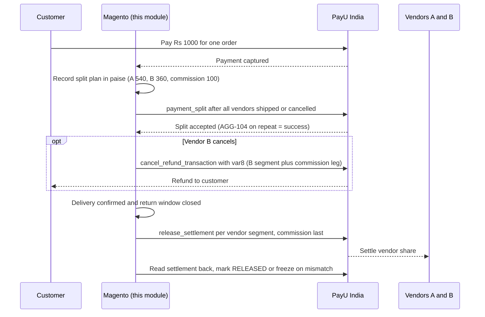
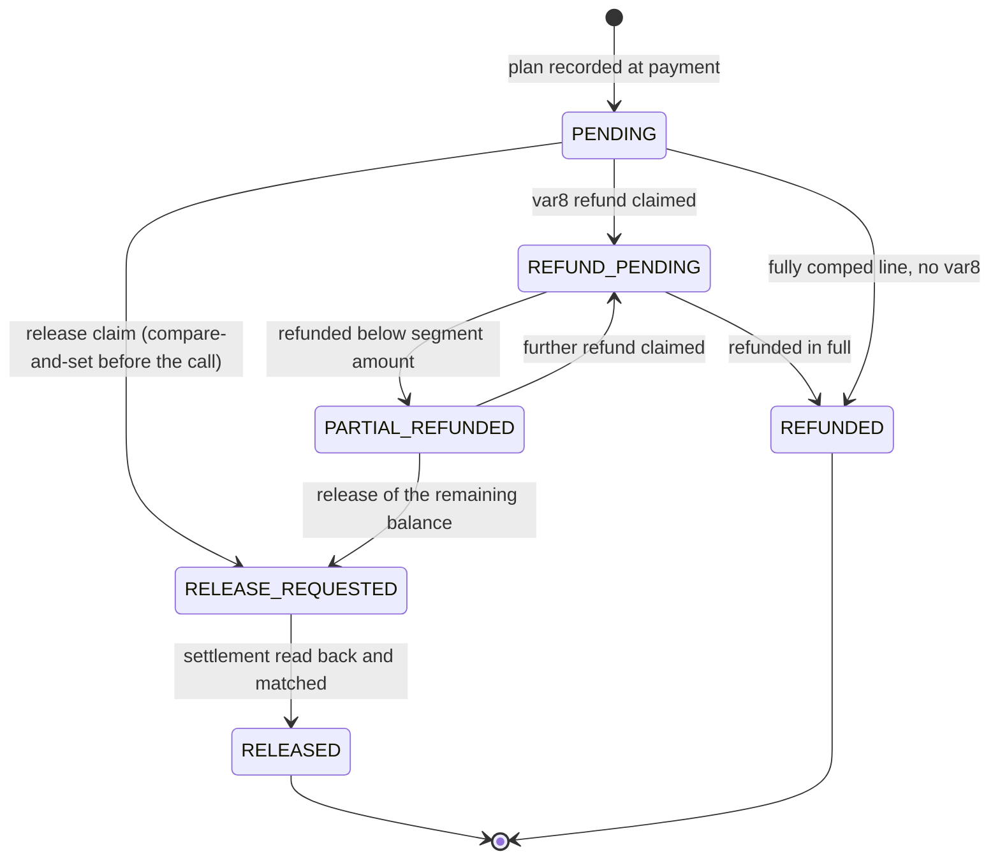

# Magento 2 PayU India Split Payment & Split Settlement Module for Multi-Vendor Marketplaces (Webkul) - `onboarding` branch

   

`RKD_PayuSplit` is a Magento 2 module for PayU India split payments: it pays each Webkul Marketplace vendor their share of a single customer payment, handles per-vendor refunds, and releases each share only after delivery and the end of the return window. It is an archived reference implementation with an engineering journal, not a drop-in extension.

> **Status: archive, not install-tested.** Built in 2026 for a Webkul-based marketplace client that moved to a different gateway before go-live, so it never ran in production. The code was renamed to `RKD\PayuSplit` for this archive and has **not been install-tested since the rename**. Settlement release has never been confirmed against a real PayU settlement. Do not run it with real money until you have verified it yourself.

> **You are looking at the `onboarding` branch.** It was cut from an earlier line than `main`, so it does **not** include release-gate items #6 to #22 (refund-status reconciliation, cancel/return holds, strand alarms, the FROZEN-hold clearing action and more; see [JOURNAL.md](JOURNAL.md) section 6). In exchange it adds the seller-onboarding tooling listed under [Branches](#branches). For a safer money path, read `main`. The two branches were never merged.

## Contents

- [Who this is for](#who-this-is-for)
- [How it works](#how-it-works)
- [Features](#features)
- [Invariants](#invariants)
- [Requirements and dependencies](#requirements-and-dependencies)
- [Getting PayU credentials (step by step)](#getting-payu-credentials-step-by-step)
- [Installation](#installation)
- [Configuration reference](#configuration-reference)
- [Cron jobs](#cron-jobs)
- [Database tables](#database-tables)
- [Admin screens and ACL](#admin-screens-and-acl)
- [Running the tests](#running-the-tests)
- [Limitations and known issues](#limitations-and-known-issues)
- [FAQ](#faq)
- [Official documentation and references](#official-documentation-and-references)
- [Build journal](#build-journal)
- [Branches](#branches)
- [Contributing and support](#contributing-and-support)
- [Licence and author](#licence-and-author)

## Who this is for

A marketplace takes **one** PayU India payment from a customer for an order that can span several vendors. Somebody then has to get each vendor their share, minus the marketplace commission, and return money correctly when an item is cancelled or returned.

The flow to avoid is collecting everything into the marketplace's own account and paying vendors out later: under India's RBI payment-aggregator rules, a marketplace that is not itself a licensed aggregator should not be the party holding customer funds in transit. PayU's **split settlement** keeps the funds with PayU. The marketplace is the "parent" merchant, each vendor is a "child" (sub-merchant), and the funds stay put until the parent releases each child's share. This module drives that lifecycle: split, refund, release. (The regulatory reading is the author's research position, not legal advice.)

**It is for you if** you run, or are building, a Webkul Marketplace store on PayU India and want a worked, heavily reviewed reference for split settlement, or a starting point to adapt.

**It is not for you if** you have no Webkul Marketplace, you are not on PayU India, or you want a drop-in install: it is coupled to project-specific `Fab_*` modules (see [Limitations](#limitations-and-known-issues)) and has not been install-tested.

## How it works

Four stages: **calculator**, **trigger**, **refund**, **release**.

### Worked example (illustrative numbers)

A customer pays Rs 1,000.00 for an order with items from vendor A (Rs 600.00) and vendor B (Rs 400.00). Assume a 10% marketplace commission.

| Segment | Owner | Amount |
|---|---|---|
| Vendor A | child merchant A | Rs 540.00 |
| Vendor B | child merchant B | Rs 360.00 |
| Commission | parent (seller id 0) | Rs 100.00 |
| **Total** | | **Rs 1,000.00** |

1. **Record.** When the payment is captured, the `sales_order_payment_pay` observer records the split plan: one segment per vendor plus the commission segment, in integer paise (`100000` here). Vendor amounts are a snapshot taken at payment and are never re-read live. Any sub-paise rounding residue lands on the parent segment, so the segments always sum to the payment exactly.
2. **Trigger.** The `rkd_payu_split_trigger_scan` cron fires `payment_split` at the earliest of three triggers: `ALL_TERMINAL` (every vendor sub-order shipped or cancelled), `MONEY_EVENT` (a refund needs the split to exist first), or `CEILING` (a hard day limit after payment, default 25, with a log alert at 23).
3. **Refund.** If vendor B cancels, `cancel_refund_transaction` is called with a `var8` parameter that names the child segment to debit plus the matching commission leg (here Rs 360.00 from B and Rs 40.00 from commission). One child-keyed `var8` queues two legs. Only the parent can refund a split transaction.
4. **Release.** `release_settlement` is called once per segment, and only when every item is delivered, every return window is closed, nothing is held, nothing is refund-pending, and the order's split is complete. The commission segment on the parent goes last, once every vendor segment is terminal. The amount PayU actually settled is read back before a segment is marked `RELEASED`; a mismatch freezes it.

**Release is switched off by default** (`rkd_payu/split/release_enabled` = 0), because it is irreversible and has never been verified against a real settlement.

Repeat-call behaviour to know: `AGG-104` on a repeat split is treated as success and followed by `get_split_info`; a `PENDING` response means poll, never re-post.

### Money flow



### Segment states

The diagram shows only the transitions that code in this repository actually writes (`ReleaseProcessor`, `ReleaseReconciler`, `RefundExecutor`, `SplitOrderManager`). The stored label is for display; per-item delivery and return rows plus separate holds decide release eligibility, so the real gate is richer than one enum (see [JOURNAL.md](JOURNAL.md) section 2).



Also declared in `Split/Model/SplitSegment.php` and offered by `Split/Model/Source/SegmentState.php`: `AWAITING_DELIVERY`, `IN_WINDOW`, `ELIGIBLE`, `CANCELLED`, `WRITTEN_OFF` and `NOT_IN_SPLIT`. They are read by the eligibility and release guards, but no code in this repository writes them. `RELEASED`, `CANCELLED`, `REFUNDED` and `WRITTEN_OFF` count as terminal.

### Split header states

Each order has one split header (`rkd_payu_split.split_state`) driven by `Split/Service/SplitStateMachine.php`: `PENDING` to `REQUESTED` (written ahead, before the POST) to `DONE`. `FAILED` is reachable from any non-terminal state. A transient problem (no transaction id yet, a `PENDING` split, a lock) is recorded without leaving the current state, so the next scan retries. `SKIPPED` marks an order with an unmapped vendor, and `NOT_REQUIRED` and `ELIGIBLE` also exist in `SplitOrder.php`.

## Features

- **Split calculator**: one segment per vendor plus the marketplace commission. Money is always integer paise; there is no float arithmetic in the money path.
- **Split trigger**: a cron job scans paid orders and sends `payment_split` to PayU at the earliest of the three triggers above.
- **Refunds**: `var8` refunds charged against the right vendor segment and the matching commission leg, with guards for over-refund, double-refund and mis-allocation.
- **Release**: a vendor's money is released only after delivery and the end of the return window, with a read-back of the amount PayU settled.
- **Write-ahead ledger and idempotent retries**: intent is written and claimed (compare-and-set) before any money-moving call, because PayU gives no idempotency key.
- **Admin diagnostics**: Loki-based grids for settlements, sub-merchants and an audit log.
- **Webkul "Pay Seller" suppressor**: stops the same money being paid twice through Webkul's own payout path, and mirrors released segments into Webkul's seller ledger.

- **Seller onboarding** (this branch): creates each approved Webkul seller as a PayU sub-merchant through PayU's OAuth onboarding API, with a queue, per-vendor lease, retry and back-off, an e-sign staff queue and e-mail alerts. See [Branches](#branches).

## Invariants

Written down before the code, and every review pass measured against them (full text in [JOURNAL.md](JOURNAL.md) section 3):

1. **Conservation of money**: segments sum to the payment, exactly, in paise.
2. **Refund bound**: refunds attributed to a vendor never exceed that vendor's segment; the commission refunded never exceeds the parent's share; total refunds never exceed the payment. Enforced locally before the request is sent.
3. **Refund attribution**: each refund debits the right segment and the matching commission leg only.
4. **Refunds based on what was actually paid**: the snapshotted paid amounts, not current order totals.
5. **Split before refund**: no refund on an un-split transaction.
6. **Refund before release**: nothing is released while a refund is pending or queued, a refunded amount is never released, and release happens at most once per segment.

## Requirements and dependencies

| Requirement | Why | Notes |
|---|---|---|
| PHP `^8.2` | `composer.json` | |
| Magento Open Source / Adobe Commerce 2.4 | Host platform | `composer.json` requires `magento/framework: *`; the exact 2.4.x range is **untested** |
| `PayUIndia_Payu` (composer `payuindia/payu` `^2.4`) | Base PayU India payment method; supplies the key, salt and environment this module reads | Required in `composer.json` |
| `Webkul_Marketplace` 5.x | Vendor, order and payout tables | Commercial, not included, not in `composer.json` |
| `Fab_Returns` | Return-window close drives the release gate; the module also reads `fab_return_request_item` by table name and listens for `fab_returns_status_changed` | Project-specific, not included |
| `Fab_ShiprocketMarketplace` | Delivery status drives the release gate (delivery poll cron) | Project-specific, not included |
| Loki Admin Components (`Loki\AdminComponents`, Yireo Loki Components) | The admin grids and forms (`etc/loki_components.xml`) | Not in `composer.json`; expect a missing-class error at `setup:di:compile` without it |

| `Fab_MarketplaceRegister`, `Webkul_Affiliate` | Listed in this branch's `etc/module.xml` load-order sequence (onboarding reads vendor data) | Project-specific / commercial, not included |

`etc/module.xml` lists the `Fab_*` modules in `<sequence>`, which only controls load order. The coupling is deeper than a swap: a replacement must provide a delivery date per vendor, a return-window close per item, and the `fab_returns_status_changed` event. There is no abstraction layer yet.

## Getting PayU credentials (step by step)

All values below are placeholders. Never commit real ones.

1. **Merchant account and test key and salt.** Register a PayU India merchant account (see [Sandbox and test credentials](#sandbox-and-test-credentials)). In the PayU merchant panel, switch to Test Mode, open Developer, then API Keys, and copy `<merchant key>` and `<salt>`. Test keys are available before onboarding finishes; no shared test credentials are published.
2. **Aggregator (parent) account with split enabled.** In the merchant panel open Split & Transfer Payments and choose Activate, which raises a ticket. Then ask your PayU account manager to enable the aggregator flag on your parent MID `<parent MID>`. Without it, `payment_split` returns `AGG-103`. A split-enabled account does not split by itself; this module (or your own code) must call the split API. Whether the flag must be enabled separately on a test account is unverified.
3. **Child merchants (vendors).** Each vendor must be a PayU child merchant (sub-merchant). Either add a sub-account manually in the parent's panel and upload the Schedule C document there (there is no API for Schedule C; PayU activates in about two working days), or use PayU's child-merchant API, which needs `aggregator_parent_mid` and `merchant_type=aggregator`. PayU answers 200 even without the parent MID and silently creates an orphan account, so the module refuses to create with a blank parent MID. The vendor's Schedule C e-sign (generate, OTP, sign) still happens in PayU's own interface. PayU's "refer merchants" partner flow creates independent merchants and is **not** a split-capable path.
4. **Onboarding OAuth client** (only if you use the onboarding API). Ask PayU to register your calling service: scopes `refer_child_merchant` and `fetch_child_merchants`, grant `client_credentials`. PayU issues `<client id>` and `<client secret>`. The merchant key is not accepted as a client id, and the two scopes are not interchangeable.
5. **Put the values into Magento.**

| Value | Config path | Notes |
|---|---|---|
| Environment (`sandbox` or `production`) | `payment/payu/environment` | Owned by `PayUIndia_Payu`. Only an explicit `sandbox` selects the test endpoints; any other value selects production |
| Merchant key | `payment/payu/merchant_key` | Owned by `PayUIndia_Payu` |
| Salt | `payment/payu/salt` | Read raw by this module (a code comment says the field has no encryption backend) |
| OAuth client id | `rkd_payu/onboarding/client_id` | Stored encrypted |
| OAuth client secret | `rkd_payu/onboarding/client_secret` | Stored encrypted |
| Parent MID | `rkd_payu/onboarding/parent_mid` | Digits only; create is refused if blank |

The module reads no `app/etc/env.php` key itself: it reads these paths through Magento's normal scope config. Set them with the Admin config or `bin/magento config:set`, or with a standard `system` override in `env.php`/`config.php`, so they stay out of the repository.

## Installation

Not install-tested since the rename. The package is not on Packagist, so install it from its Git repository, or copy it in.

```
app/code/RKD/PayuSplit/   <- the repository root goes here
bin/magento module:enable RKD_PayuSplit
bin/magento setup:upgrade && bin/magento setup:di:compile
```

Before enabling, make sure the dependencies above are installed. Then configure release **off** (the default), run in test mode, and read [Limitations](#limitations-and-known-issues).

## Configuration reference

Stores > Configuration > tab "ALLYNOR" (the original client's brand, still in `etc/adminhtml/system.xml`; rename it in your fork) > "PayU Diagnostics". The `diagnostic` group has default, website and store scope; every other group is default scope only.

| Path | Default | Meaning |
|---|---|---|
| `rkd_payu/diagnostic/log_enabled` | 1 | Structured diagnostic log to `var/log/payu.log` |
| `rkd_payu/diagnostic/redact_pii` | 0 | Mask name, e-mail and phone in logs. Salt and key are never logged |
| `rkd_payu/split/ceiling_days` | 25 | Latest day (after payment) by which the split must fire |
| `rkd_payu/split/alert_days` | 23 | Log a warning when an order is still un-split at this age; keep it below the ceiling |
| `rkd_payu/split/scan_batch_size` | 200 | Max split headers per trigger run |
| `rkd_payu/split/enable_rearm_refund` | 0 | Opt-in break-glass: re-arm a refund leg |

| `rkd_payu/split/release_enabled` | 0 | Master kill switch for release and its readback reconciliation |
| `rkd_payu/onboarding/enabled` | 0 | Master switch for sub-merchant creation |
| `rkd_payu/onboarding/client_id`, `client_secret` | none | OAuth credentials (encrypted) |
| `rkd_payu/onboarding/parent_mid` | none | Aggregator parent MID |

| `rkd_payu/onboarding/monthly_expected_volume` | blank (sends 60000) | Monthly expected volume per vendor in INR, sent on every create (this branch only) |
| `rkd_payu/onboarding/alert_email` | blank (store contact) | Recipient for onboarding failure and e-sign alerts (this branch only) |


## Cron jobs

Magento cron must be running. All classes are under `RKD\PayuSplit\Split\Cron\`.

| Job | Schedule | What it does | Gated by |
|---|---|---|---|
| `rkd_payu_split_trigger_scan` | `*/15 * * * *` | Fires `payment_split` at the earliest trigger | none |
| `rkd_payu_release_executor_scan` | `3,18,33,48 * * * *` | Fires `release_settlement` for eligible segments | `release_enabled` |
| `rkd_payu_refund_executor_scan` | `5,20,35,50 * * * *` | Issues `var8` refunds for cancelled vendor segments | none |
| `rkd_payu_webkul_sync_recon_scan` | `6,21,36,51 * * * *` | Re-drives the Webkul ledger mirror for released segments | `release_enabled` |
| `rkd_payu_delivery_poll_scan` | `10,25,40,55 * * * *` | Polls delivery per vendor segment, stamps delivered and return-window dates | none |
| `rkd_payu_release_recon_scan` | `12,27,42,57 * * * *` | Reads settlement back, marks RELEASED or freezes a mismatch | `release_enabled` |

| `rkd_payu_onboarding_scan` | `*/5 * * * *` | Moves approved vendors through create and bank-attach to the e-sign queue | no-op unless `rkd_payu/onboarding/enabled` |

This branch has 7 jobs. `main` instead has 11: the same six plus five reconciliation and alarm jobs (refund-close recon, refund-status recon and three daily strand alarms) that this branch lacks. A console command, `fab:payu:onboarding:run`, runs the onboarding scan (or one seller) on demand.


## Database tables

Seven tables, declared in `etc/db_schema.xml`, with the same names on both branches.

| Table | Purpose |
|---|---|
| `rkd_payu_submerchant` | Maps a Webkul seller to its PayU child sub-merchant (the split payee). This branch adds retry, back-off, lease, error-class and e-mail columns and a unique `payu_uuid` |
| `rkd_payu_split` | Per-order split lifecycle header |
| `rkd_payu_split_segment` | Per (order, seller) settlement segment; seller id 0 is the parent commission segment |
| `rkd_payu_segment_item` | Per-item delivery and return-window gating under a segment |
| `rkd_payu_refund` | `var8` refund legs, written ahead of the call |
| `rkd_payu_segment_hold` | Active holds that block a segment's release |
| `rkd_payu_audit_log` | Audit trail of break-glass settlement admin actions |

The module also reads Webkul's tables by name. This branch lacks some columns `main` added (for example `refund_attempts`, `delivered_qty` and `return_opened_at`).


## Admin screens and ACL

Under Sales > Operations (`etc/adminhtml/menu.xml`):

| Menu | Route | ACL resource |
|---|---|---|
| PayU Settlements | `rkd_payu/settlement/index` | `RKD_PayuSplit::settlements` |
| PayU Submerchants | `rkd_payu/submerchant/index` | `RKD_PayuSplit::submerchants` |
| PayU Settlement Audit | `rkd_payu/audit/index` | `RKD_PayuSplit::settlements` |

Other resources: `RKD_PayuSplit::settlement_manage` (break-glass actions), `RKD_PayuSplit::config` (the configuration section, so the release kill switch can be granted to a scoped role).

Settlement actions: `RetrySplit` and `RearmRefund` (no `ClearFrozenHold` here). Submerchant actions: `Retry`, `Link`, `Deactivate`, `Reactivate`, `MarkEsignSent`, `ResetLegacy` and `ForgetMark`, protected by the extra `RKD_PayuSplit::submerchant_manage` resource. Four Loki guard plugins (`Plugin/Loki/`, wired in `etc/adminhtml/di.xml`) put ACL checks on Loki's generic write, read and block paths.

## Running the tests

There are 85 `*Test.php` files under `Test/`. There is no `phpunit.xml`, no `require-dev` and no bootstrap in this repository, so the tests only run inside a Magento 2.4 install with the dependencies present or stubbed. **The suite has not been re-run since the rename**, and the commands below are untested.

1. Place the repository at `app/code/RKD/PayuSplit/` in a Magento 2.4 project (PHP 8.2+) with `vendor/` installed.
2. The tests import classes from outside this repository (`Webkul\Marketplace\*`, `PayUIndia\Payu\Model\Payu`, `Fab\Returns\*`, `Fab\ShiprocketMarketplace\Api\DeliveryStatusProviderInterface`, `Loki\AdminComponents\*`), so provide the real modules or stubs. One stub helper exists: `Test/Unit/Split/_stubs/BackendSessionStub.php`.
3. From the Magento root:

```
vendor/bin/phpunit -c dev/tests/unit/phpunit.xml.dist app/code/RKD/PayuSplit/Test/Unit
```

`Test/Unit/CodingStandardsGuardTest.php` scans production files on disk and still carries pre-rename wording; run it from an in-place install.

## Limitations and known issues

- **Not install-tested** since the rename; no Packagist release.
- **Release has never been confirmed in UAT or production.** PayU's test environment cannot simulate real settlement, and the planned small real-money check never happened. Whether release pays net or gross after a partial refund is unverified.
- **Refunds queue but were never seen to complete in UAT**, so there is no end-to-end proof of money returning.
- **Unknowns with PayU:** how a suspended child merchant's share is treated, and whether the commission segment on the parent auto-settles (which would break "parent last").
- **Hard coupling to `Fab_*` modules** and to Webkul table names (see [Requirements](#requirements-and-dependencies)). Refund-on-return is deferred to a returns v2 that does not exist here, so an approved return blocks release and only raises an alarm.
- **No webhooks**: all PayU state is polled.
- **Loki dependency** is not declared in `composer.json`; `magento/framework` is `*`, so compatibility is not signalled.
- **Branches never merged** (see [Branches](#branches)).
- The admin tab still carries the original client's brand, the console command is named `fab:payu:onboarding:run`, and a few docblocks keep pre-rename wording.
- Regulatory notes are research, **not legal advice**.

## FAQ

**Does it work without Webkul Marketplace?** No. Vendor, order and payout data come from Webkul tables.

**Without the `Fab_*` modules?** Not out of the box. You must supply a delivery date per vendor, a return-window close per item and the `fab_returns_status_changed` event, or edit the code. There is no abstraction yet.

**Can I use another gateway?** No. The calls (`payment_split`, `release_settlement`, `cancel_refund_transaction`, `get_split_info`, `check_action_status`) are PayU India's.

**Why is release off by default?** It is irreversible (there is no documented way to undo a release) and it was never verified against a real settlement. Turn it on only after you have proven it with a small real order.

**What happens if the split ceiling passes?** The ceiling trigger fires the split regardless of delivery, as a compliance control: an un-split aggregator transaction may auto-settle, which would leave the marketplace holding customer funds. A warning is logged from `alert_days`.

**Why are refunds two legs?** One child-keyed `var8` debits the vendor's segment and the matching commission leg, so the commission share is returned along with the vendor's.

**Is it PCI or RBI compliant?** This README makes no compliance claim, and nothing here is legal advice.

**Where are the logs?** `var/log/payu.log` (toggle with `rkd_payu/diagnostic/log_enabled`).

## Official documentation and references

Documentation pages only. Checked on 2026-11-27 (a few PayU pages return 403 to scripted requests but open in a browser).

### Split settlement
- [Split settlements overview](https://docs.payu.in/docs/introduction-split-settlements)
- [Split settlements product page](https://docs.payu.in/docs/split-settlments)
- [Aggregator / marketplace settlement solution](https://docs.payu.in/docs/aggregator-or-marketplace-settlement-solution)
- [Activate split settlements](https://docs.payu.in/docs/activate-split-settlements)
- [API integration for split settlements](https://docs.payu.in/docs/api-integration-for-split-settlements)
- [Create the split](https://docs.payu.in/docs/create-the-split)
- [View split transaction details](https://docs.payu.in/docs/view-split-transaction-details)
- [Split settlements FAQs](https://docs.payu.in/docs/faqs-for-split-settlements)

### Payments and the split APIs
- [Split during a transaction using `_payment`](https://docs.payu.in/reference/split-during-transaction-using-_payment)
- [Absolute-amount split at payment time](https://docs.payu.in/docs/absolute-split-during-transaction-integration)
- [`payment_split`: split after the transaction](https://docs.payu.in/reference/split_after_transaction_api)
- [`get_split_info`](https://docs.payu.in/reference/get_split_info_api)

### Settlement and refunds
- [Settlement APIs overview](https://docs.payu.in/docs/settlement-apis-split-settlements)
- [`release_settlement`](https://docs.payu.in/reference/release_settlement_api)
- [Settlement details](https://docs.payu.in/reference/settlement-details-1)
- [Refund APIs for split settlements](https://docs.payu.in/docs/refund-apis-for-split-settlements)
- [Refunds for split transactions (`var8`)](https://docs.payu.in/reference/refund-apis-split-settlements.md)
- [`cancel_refund_transaction`](https://docs.payu.in/reference/refund_transaction_api)
- [`check_action_status`](https://docs.payu.in/reference/check_action_status_api_with_request_id)

### Onboarding and OAuth
- [Child merchant APIs](https://docs.payu.in/reference/onboarding-child-merchants-apis)
- [Create child merchant](https://docs.payu.in/reference/create-child-merchant-api)
- [OAuth token, scopes `refer_child_merchant` and `fetch_child_merchants`](https://docs.payu.in/reference/generate-token-using-private-client-id)
- [Refer merchants using the API (independent merchants, not split children)](https://docs.payu.in/docs/refer-merchants-using-api)
- [Onboarding and KYC APIs](https://docs.payu.in/reference/onboarding-and-kyc-apis)
- [Complete your KYC](https://docs.payu.in/docs/complete-your-kyc)
- [Documents checklist for account activation](https://docs.payu.in/docs/documents-checklist-for-account-activation)

### Webhooks (this module polls and does not use them)
- [Webhooks](https://docs.payu.in/docs/webhooks)
- [Webhook events and sample payloads](https://docs.payu.in/docs/webhook-events-and-sample-payloads)
- [Refund webhooks](https://docs.payu.in/docs/webhooks-for-refunds.md)

### Sandbox and test credentials
- [Generate a test merchant key and salt](https://docs.payu.in/docs/generate-test-merchant-key-and-salt)
- [PayU docs home](https://docs.payu.in/) and [machine-readable index](https://docs.payu.in/llms.txt)

### Magento, Webkul and the PayU extension
- [`payuindia/payu` on Packagist](https://packagist.org/packages/payuindia/payu)
- [PayU Magento 2 plugin docs](https://docs.payu.in/docs/magento)
- [Webkul Marketplace (commercial)](https://store.webkul.com/magento2-multi-vendor-marketplace.html)
- [Adobe Commerce / Magento developer docs](https://developer.adobe.com/commerce/)

### RBI payment-aggregator regulation (context, not advice)
- [RBI](https://www.rbi.org.in/) (primary source)
- [RBI Payment Aggregators Directions, 15 Sep 2025 (third-party mirror)](https://www.fidcindia.org.in/wp-content/uploads/2025/09/RBI-PAYMENT-AGGREGATORS-DIRECTIONS-15-09-25.pdf)

## Build journal

[JOURNAL.md](JOURNAL.md) is the real write-up: the problem, the architecture, the PayU API behaviour found by experiment, the review process, why the project stopped and what I would do differently. If you only read one file besides this one, read that.

## Branches


| Branch | Contents |
|---|---|
| `main` | The split engine with the full release-gate hardening (items #1 to #22, defined in [JOURNAL.md](JOURNAL.md) section 6). It also contains the sub-merchant OAuth client, payload builder, table, grid and config group |
| `onboarding` (this one) | Cut from an earlier line, so it lacks gate items #6 to #22. Compared with `main` it adds: the onboarding cron (`rkd_payu_onboarding_scan`) and processor, queue, claim/lease and pre-flight services, the `fab:payu:onboarding:run` console command, an approval observer (`mp_approve_seller`), seven submerchant staff actions, four Loki admin guard plugins, an onboarding e-mail alert, the `submerchant_manage` ACL resource, two extra config fields, extra `rkd_payu_submerchant` columns, and `Fab_MarketplaceRegister` / `Webkul_Affiliate` in its load-order sequence |

What this branch lacks compared with `main`: the cancel-hold, return-open and refund-close observers, refund-status reconciliation, the three strand alarms, the `ClearFrozenHold` action and `enable_clear_hold` setting, the `BackfillDeliveredQty` data patch, and the `refund_attempts`, `delivered_qty` and `return_opened_at` columns. The two branches were never merged.

## Contributing and support

This is an **archive**. Issues are welcome (use the repository's Issues tab), but there is no active maintenance and no promised response time. Pull requests may sit unreviewed. If you find a security problem, report it privately and never post credentials, order data or customer details in an issue.

## Licence and author

MIT. See [LICENSE](LICENSE).

Author: Robin Dhiman ([devrob.in](https://devrob.in)).
